# Diario di Wisper

La storia di Wisper versione per versione: cosa è cambiato, quando e perché.
Le novità più recenti sono in alto.

Il diario è iniziato il 20 ottobre 2026. Per i giorni precedenti l'ho ricostruito
da tre fonti: i commit, le versioni pubblicate su GitHub e le conversazioni di
lavoro di quei giorni. Le schermate sono state fatte il giorno stesso, durante le
prove. Mostrano sempre dati di esempio (Rossi Impianti, Batokyo, Mario Bianchi…),
mai dati veri di clienti.

| Data | Versione | In breve |
|------|----------|----------|
| 21/10/2026 | 0.4.0 | [Tutto l'ufficio anche sul telefono](#v0-4-0) |
| 20/10/2026 | solo foglio | [Il foglio trova l'email del proprietario anche senza il permesso apposta](#permesso-email) |
| 20/10/2026 | solo foglio | [L'email per collegare il computer serve anche a installare Wisper Ufficio](#installa-da-email) |
| 20/10/2026 | 0.3.6 | [Il computer si collega dal telefono; la settimana sta sopra a oggi](#v0-3-6) |
| 20/10/2026 | 0.3.5 | [Codici commessa 26ST, Elettrodinamica a tariffa fissa, budget e margine](#v0-3-5) |
| 19/10/2026 | 0.3.4 | [Il codice salvato si vede, e un codice sbagliato viene detto chiaro](#v0-3-4) |
| 17/10/2026 | 0.3.3 | [Niente indirizzo del foglio nei file pubblicati, partita IVA con lo zero, registro degli accessi](#v0-3-3) |
| 16/10/2026 | 0.3.0 → 0.3.2 | [Un solo file .exe, aggiornamenti automatici, installazione da sola](#v0-3-0) |
| 15/10/2026 | 0.2 | [Nuovo design: Oggi sul telefono, Fine mese sul computer](#design) |
| 14–15/10/2026 | 0.2.0 | [Niente più voce: rapportini a mano, il foglio come archivio, Wisper Ufficio](#v0-2-0) |
| 26/09–14/10/2026 | 0.1 | [Un rapportino confermato non si perde più](#coda) |
| 7–9/08/2026 | 0.1.0 | [Hackathon NGN Hacks: la versione a voce, senza mani](#v0-1-0) |
| marzo–giugno 2026 | prima del repository | [Le prime versioni](#prima) |

---

## 21 ottobre 2026 · 0.4.0 · Tutto l'ufficio anche sul telefono

**Perché.** Il papà ha chiesto di *"portare tutto quello che c'è sul computer anche sul telefono"*, e
*"letteralmente tutto"*. Il computer resta il posto principale: sul telefono l'ufficio serve quando è in giro,
per fatturare, guardare una commessa o mandare un PDF. Prima è stato fatto un prototipo da toccare, partendo da una
ricerca su come le app migliori di questo tipo (fatture, ore, lavori sul campo) mettono l'ufficio sul telefono. Il
prototipo è stato approvato, poi sono state costruite le schermate vere
([`docs/telefono-ufficio.md`](docs/telefono-ufficio.md), prototipo in
[`docs/prototipo/TelefonoUfficio.html`](docs/prototipo/TelefonoUfficio.html)).

**Cosa cambia.**

- **Una barra in basso con tre voci: Oggi · Rapportini · Ufficio.** Oggi non cambia; il numerino giallo su Ufficio
  dice quanti clienti ci sono da fatturare.
- **Ufficio** si apre sulla fine del mese, come Wisper Ufficio: da fatturare, da firmare, fatturato; una scheda per
  cliente con *Prepara riepilogo*; le bozze da far firmare; le commesse vicine al budget o oltre; poi Commesse,
  Clienti e Impostazioni.
- **Il riepilogo si prepara e si manda dal telefono.** L'anteprima è il PDF vero, che si apre a tutto schermo con lo
  zoom. Si sceglie se mettere gli importi e le foto degli scontrini, si cambia il messaggio, e si manda per email; in
  più *Apri il PDF* e *Condividi* (WhatsApp, Gmail…). Poi *Segna fatturati*, con *Annulla* per qualche secondo.
- **Rapportini** prende il posto del Mese: ricerca, il mese dal titolo (anche tutti i mesi), *Tutti | Da fatturare |
  Da firmare*, i filtri che arrivano da un cliente o da una commessa, e *Seleziona* per agire su più rapportini.
- **Il rapportino aperto** ha un solo pulsante giallo, la cosa da fare adesso (Invia al cliente, Segna fatturato,
  PDF), e nel menu ⋯ le stesse voci del computer, compreso *Carica il foglio firmato*.
- **Commesse**: elenco con la barra delle ore sul budget, pagina con le cinque schede del computer (Panoramica,
  Rapportini, Costi, Da fatturare, Documenti su Drive), modulo con ore, prezzo e budget collegati e il margine che si
  aggiorna mentre si scrive.
- **Clienti**: elenco, scheda con i contatti da copiare con un tocco, modifica a pagina intera.
- **Impostazioni complete**: lo studio, la tua firma (rifatta col dito o da una foto), rimborso km e costo orario, il
  campo ticket.
- **I PDF si fanno sul telefono dagli stessi modelli del computer**, copiati nell'app quando la si costruisce:
  rapportino e riepilogo escono identici.
- **Senza rete**: i cambi di stato (inviato, fatturato, in bozza) partono appena c'è rete, come i rapportini. Email,
  clienti, commesse e impostazioni vogliono la rete, e un'email non viene mai ripetuta da sola (partirebbe due volte).
- La visita guidata ha un passo in più, sull'Ufficio.

Le schermate vengono dall'emulatore, collegato al foglio finto delle prove.

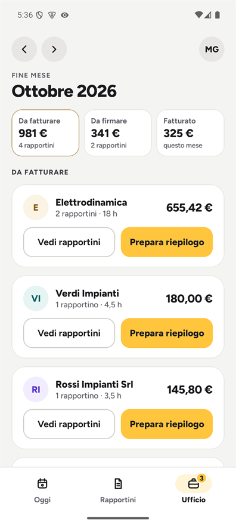
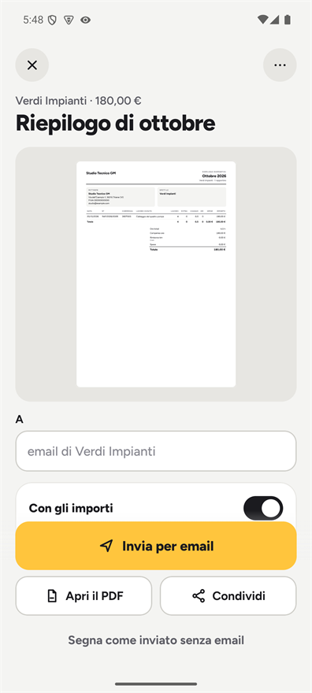
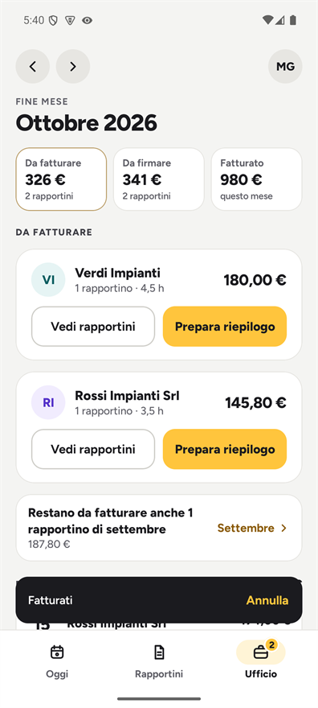

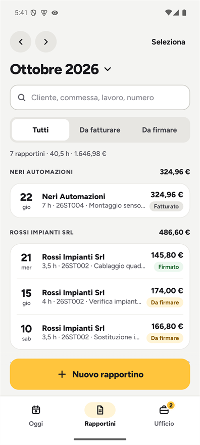
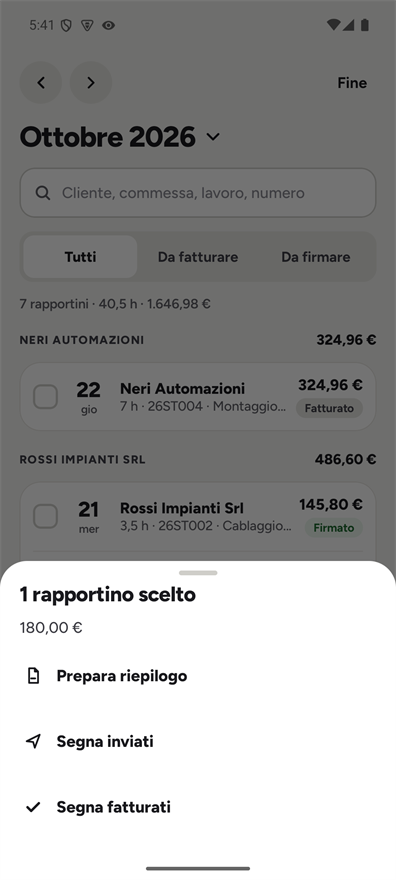
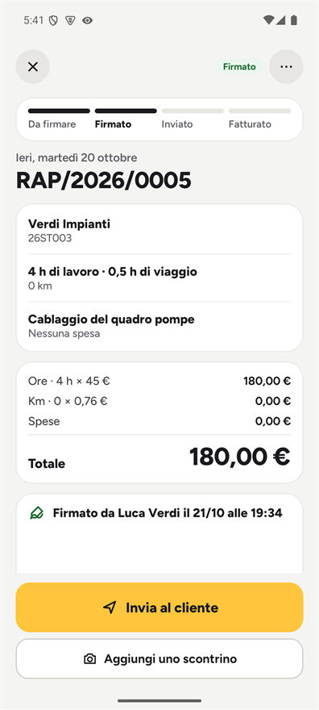

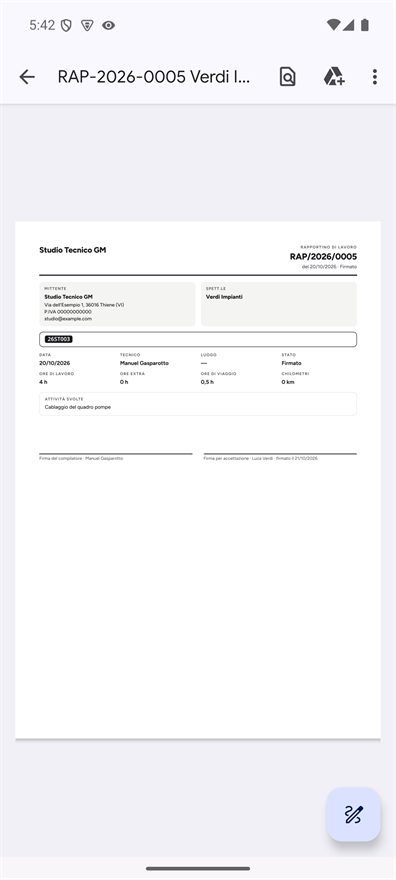
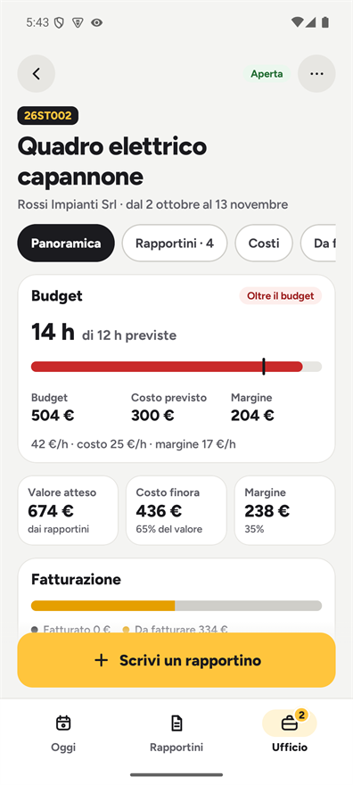
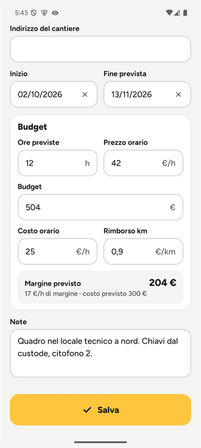

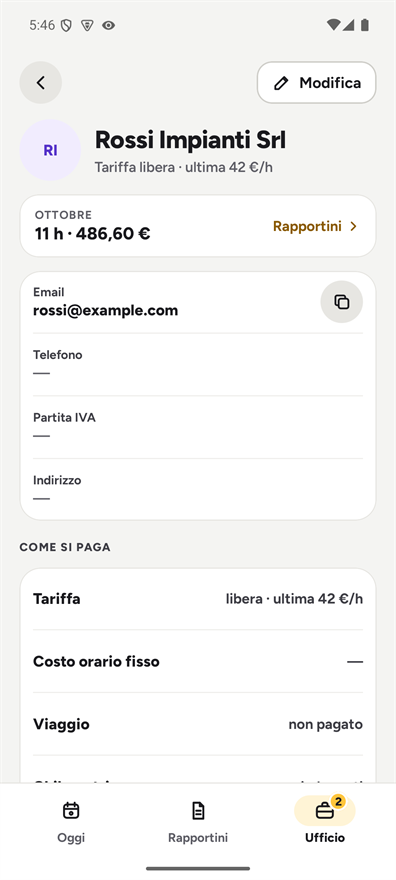
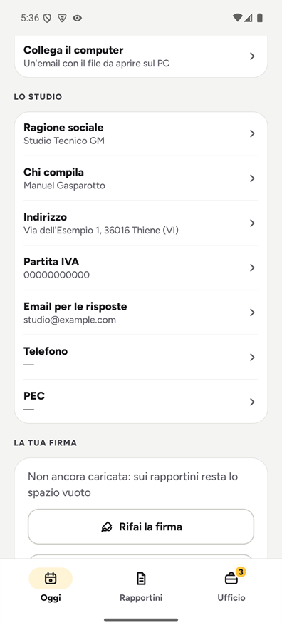
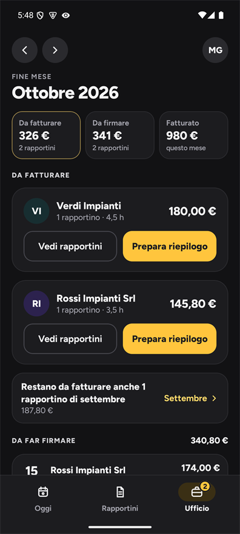

Versione: [v0.4.0](https://github.com/postagaspa-star/wisper/releases/tag/v0.4.0)

---

## 20 ottobre 2026 · solo foglio · L'email del proprietario, anche senza permesso

**Perché.** La prima prova vera di *Collega il computer* si è fermata con questo
errore: *"Le autorizzazioni specificate non sono sufficienti per chiamare
Session.getEffectiveUser"*. Per leggere l'email di chi possiede il foglio, Google
vuole un permesso apposta (`userinfo.email`). Quell'errore di solito vuol dire che
il progetto Apps Script ha l'elenco dei permessi scritto a mano (in
`appsscript.json`) e quel permesso manca. Lo stesso errore fermava, senza dire
niente, anche gli avvisi di sicurezza della 0.3.3 (dispositivo nuovo, troppi codici
sbagliati): con ogni probabilità dal 17 ottobre non ne è arrivato nessuno.

**Cosa cambia.**

- Se il permesso manca, lo script chiede a Drive di chi è il foglio, con il
  permesso che ha già per le foto. L'email per collegare il computer, gli avvisi
  del registro e "manda a me" usano tutti questa strada.
- Una funzione nuova, `autorizza`, da eseguire a mano nell'editor di Apps Script
  dopo aver incollato una versione nuova: Google chiede i permessi che mancano, e
  il registro di esecuzione dice se l'email del proprietario si legge e quante
  email si possono ancora mandare oggi. Non cambia niente nel foglio.
- Se nemmeno Drive risponde, il telefono dice di eseguire `autorizza`.

---

## 20 ottobre 2026 · solo foglio · L'email serve anche a installare Wisper Ufficio

**Perché.** Subito dopo la 0.3.6, la domanda: *"E per installare Wisper Ufficio
come facciamo? Possiamo fare lo stesso procedimento?"*

**Cosa cambia.** L'email che arriva toccando *Collega il computer* sul telefono ora
contiene anche il link per scaricare l'ultima versione di Wisper Ufficio. Così su
un computer nuovo bastano due passi, tutti dalla stessa email:

1. si scarica il programma dal link e lo si apre: si installa da solo e mette
   l'icona sul Desktop. Se Windows avvisa che ha protetto il PC, si tocca
   "Ulteriori informazioni" e poi "Esegui comunque";
2. si apre con un doppio clic l'allegato `Collega Wisper Ufficio.wisper`, e il
   programma si collega al foglio.

Il link punta sempre all'ultima versione pubblicata, quindi l'email non va mai
aggiornata. Non serve una versione nuova delle app: cambia solo lo script del
foglio (`Code.gs`), e vale da quando viene incollato in Apps Script.

---

## 20 ottobre 2026 · 0.3.6 · Il computer si collega dal telefono

**Perché.** Due richieste: *"la sezione dei rapportini della settimana deve essere
sopra a quella dei rapportini di oggi nel telefono"*, e *"nel pc mettimi
automaticamente il codice per collegare l'app al foglio"*.

Mettere il codice dentro il programma avrebbe voluto dire pubblicarlo: i file su
GitHub li può scaricare chiunque, e quello che c'è dentro un programma si può
leggere. Così il codice arriva per un'altra strada, un'email che parte solo verso
il proprietario del foglio.

**Cosa cambia.**

- **Telefono, Oggi:** la settimana ora sta sopra al rapportino di oggi.
- **Telefono, Impostazioni › Collega il computer:** il telefono chiede al foglio di
  mandare al proprietario un'email con un piccolo file, `Collega Wisper
  Ufficio.wisper`, che contiene indirizzo e codice. Anche chi conoscesse il codice
  non potrebbe farsi mandare l'email altrove.
- **Computer:** col doppio clic sul file, Wisper Ufficio si collega da solo e
  cancella il file. Se il doppio clic non funziona, c'è *Impostazioni › Usa il
  file dell'email*. Un programma già aperto si accorge del collegamento nuovo
  alla prima lettura del foglio.
- **Telefono, Tariffe:** l'elenco mostra i clienti a tariffa fissa
  (Elettrodinamica) e "gli altri clienti: libera", al posto dei vecchi gruppi.

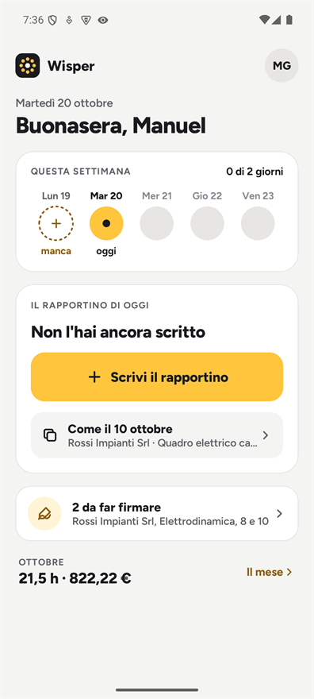
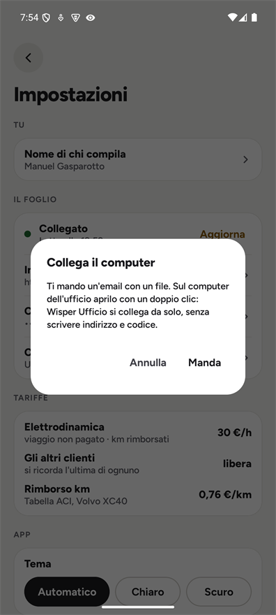
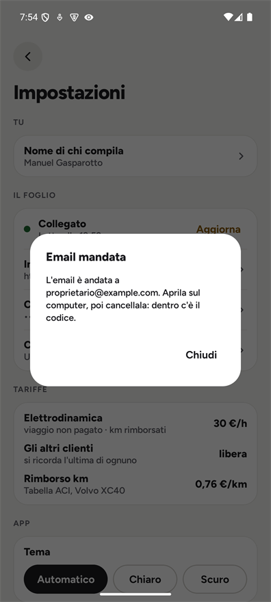

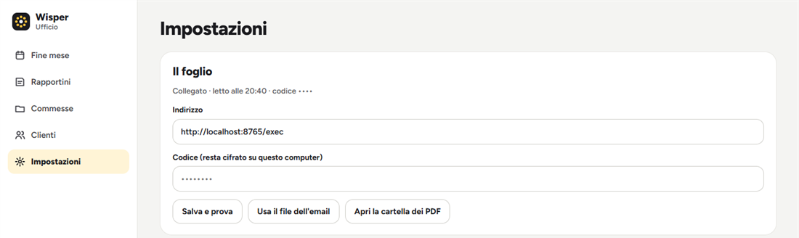

Commit: [1fc5ecd](https://github.com/postagaspa-star/wisper/commit/1fc5ecd)

---

## 20 ottobre 2026 · 0.3.5 · Codici commessa, Elettrodinamica, budget

**Perché.** La sera del 19 ottobre il papà ha lasciato su un foglio di carta le
indicazioni per i prossimi aggiornamenti. La mattina dopo le abbiamo chiarite:

- il codice della commessa è *26* perché è l'anno, *ST* fisso perché il papà
  fattura sempre come Studio Tecnico GM, poi un numero progressivo;
- i nomi scritti nel foglio erano solo esempi;
- la divisione tra "Elettrodinamica" e "privati" non deve esserci più. Il papà
  fattura a Elettrodinamica in generale, e per chi lavori Elettrodinamica non
  conta: Elettrodinamica è un cliente, con la sua tariffa fissa;
- nei riepiloghi e nella colonna COMMESSA ci va il codice;
- il rimborso al chilometro può cambiare da commessa a commessa.

Poi il budget. Il prezzo orario cambia da commessa a commessa, tranne per
Elettrodinamica, dove è fisso. Il costo orario lo scrive chi usa l'app, e
comprende già le ore di viaggio. Per Elettrodinamica serviva *"una sezione
facoltativa nel cliente dove si può inserire un costo fisso"*. Infine una
correzione sulle prime schermate: il margine stimato era uguale al budget, ma
*"il margine sono i soldi dopo i costi"*.

**Cosa cambia.**

- **Codici commessa** anno + ST + numero (26ST001, 26ST002, …). Il numero continua
  da un anno all'altro (27ST047). Il codice compare appena la commessa è creata,
  anche sul telefono senza rete: il telefono propone il numero successivo, e se
  intanto è stato preso il foglio usa il primo libero.
- **Niente più gruppi.** Elettrodinamica è un cliente a tariffa fissa (30 €/h,
  viaggio non pagato, km pagati). Tutti gli altri hanno una tariffa libera, che
  viene ricordata. Fatture, Fine mese e riepiloghi sono per cliente.
- **La colonna COMMESSA** dei rapportini contiene il codice; riepiloghi e PDF
  mostrano il codice al posto della descrizione.
- **€/km per commessa**, se una commessa ha un rimborso diverso.
- **Budget della commessa:** ore previste × prezzo orario = budget (bastano due
  dei tre numeri per avere il terzo), più il costo orario e il margine. Il prezzo
  della commessa viene proposto come tariffa nel rapportino, e resta modificabile.
  Il costo orario si prende dal cliente se ha un costo fisso, altrimenti dalla
  commessa, altrimenti dalle impostazioni. Il margine atteso è il valore meno i
  costi previsti.
- **Il foglio esistente si sistema da solo** alla prima richiesta: crea il cliente
  Elettrodinamica e ci sposta i rapportini e le commesse dei suoi vecchi clienti
  finali (le righe restano, i vecchi nomi diventano alias). Inoltre dà un codice
  26ST alle commesse vecchie e lo scrive nella colonna COMMESSA.

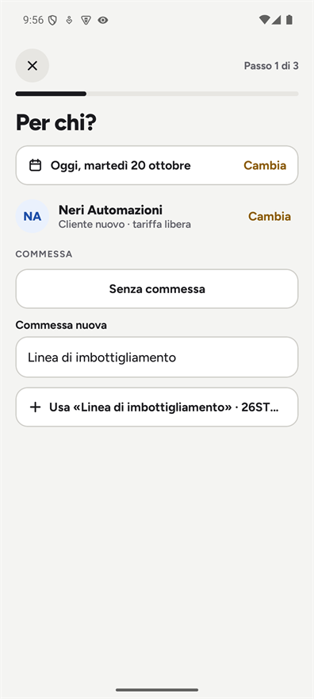
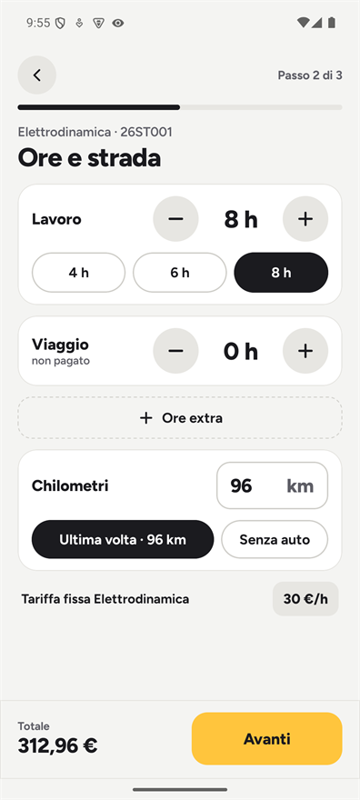
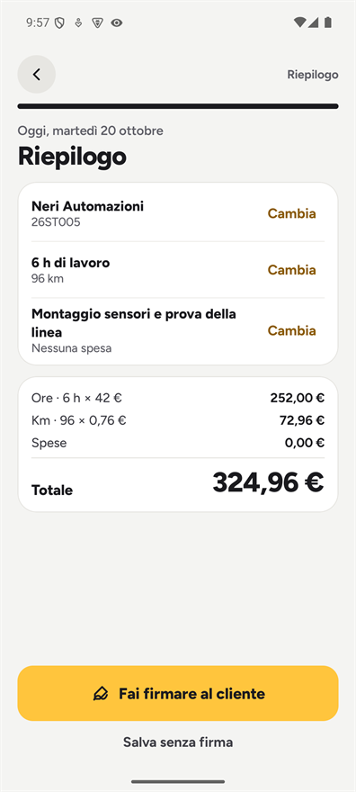

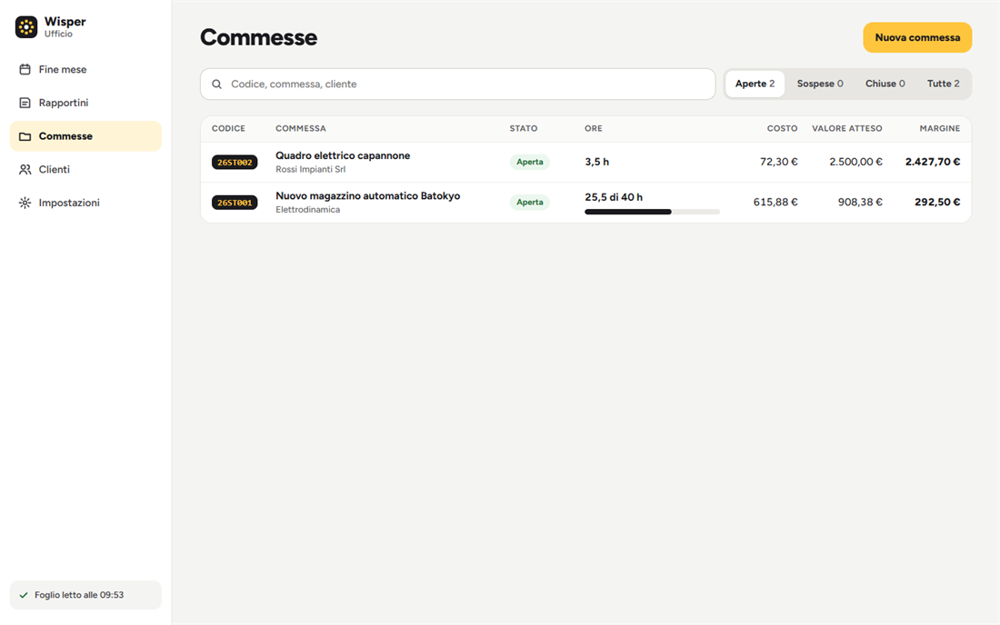

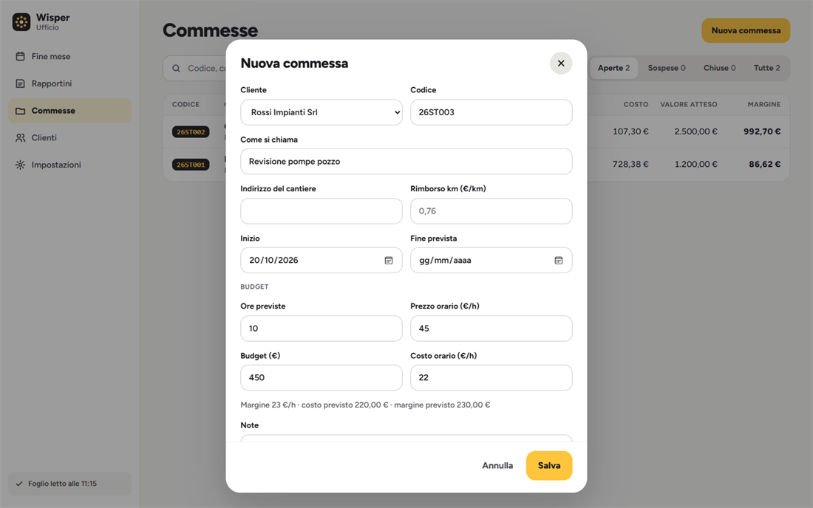

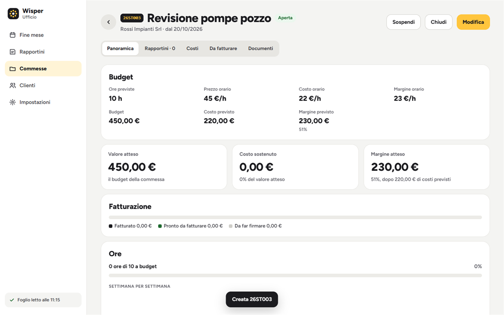

Commit: [21585d9](https://github.com/postagaspa-star/wisper/commit/21585d9)

---

## 19 ottobre 2026 · 0.3.4 · Il codice salvato si vede

**Perché.** *"Nell'app per il pc il codice una volta inserito non rimane, oppure
dopo un cambiamento nel codice, come in quello di AppScript, poi viene
resettato."*

In realtà il codice restava salvato, ma il campo in Impostazioni era sempre vuoto,
quindi sembrava perso. E quando il codice veniva cambiato nello script, il
programma diceva "il foglio non risponde" invece di dire cosa era successo.

**Cosa cambia** (solo computer; il telefono resta alla 0.3.3).

- Il campo del codice mostra le ultime quattro lettere del codice salvato (come
  sul telefono), e la riga del collegamento lo ripete.
- Se il foglio risponde "Codice sbagliato", il programma lo dice: apre
  Impostazioni con il campo del codice già selezionato, e nella barra a sinistra
  compare "Codice da aggiornare".

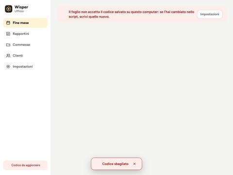
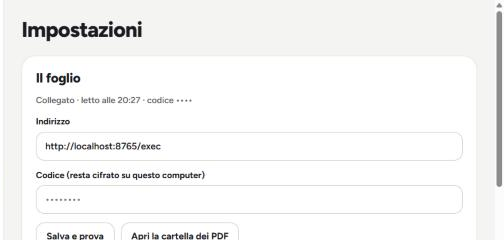

Commit: [a51ef39](https://github.com/postagaspa-star/wisper/commit/a51ef39)

---

## 17 ottobre 2026 · 0.3.3 · Sicurezza, partita IVA, registro degli accessi

**Perché.** Quel giorno si stavano raccogliendo idee per le funzioni future, con un
"consiglio" di tre esperti che le discutevano (proposte messe in pausa). Poi sono
arrivate tre cose urgenti: il problema della partita IVA; il fatto che
l'indirizzo del foglio fosse leggibile su GitHub (*"toglilo immediatamente da
GitHub, ma fai in modo che nel codice rimanga"*); e un registro per *"capire da
quale dispositivo derivano"* le richieste, e capire se ci sono state perdite di
dati.

**Cosa cambia.**

- **L'indirizzo del foglio non entra più nei file pubblicati.** Resta nel codice
  sul computer di sviluppo, in un file che non va su GitHub. Telefono e computer
  lo salvano al primo avvio, così gli aggiornamenti senza indirizzo continuano a
  funzionare. Lo script di pubblicazione si rifiuta di pubblicare se lo trova nei
  file. Le versioni 0.3.0 e 0.3.2 restano elencate su GitHub, ma senza i file da
  installare.
- **Partita IVA con lo zero.** Google Fogli trasformava in numeri i testi fatti
  solo di cifre, e così le partite IVA e i numeri fissi perdevano lo zero
  iniziale, anche quando si modificava un altro campo della riga. Ora questi
  valori vengono scritti come testo, e quelli già rovinati vengono sistemati da
  soli alla prima richiesta.
- **Registro degli accessi.** Google non fa vedere allo script l'indirizzo IP di
  chi chiama, quindi ogni telefono e ogni computer si crea un codice suo al primo
  avvio e lo manda a ogni richiesta. Ogni richiesta lascia una riga nella scheda
  *Accessi* (ora, esito, azione, dispositivo, versione dell'app); la scheda
  *Dispositivi* elenca i dispositivi visti. Il proprietario riceve un'email per
  un dispositivo mai visto, per una richiesta senza nome ma con il codice giusto,
  e dopo 5 codici sbagliati. Il codice non viene mai scritto nel registro.

Commit: [0f92bca](https://github.com/postagaspa-star/wisper/commit/0f92bca)

---

## 16 ottobre 2026 · 0.3.0 → 0.3.2 · Un solo .exe che si aggiorna da solo

**Perché.** *"Io vorrei un qualcosa di più semplice sul pc, tipo un file .exe, come
su Pactum. Inoltre entrambe le applicazioni si devono auto-aggiornare, con dei
ping ogni 1h per richiedere al server eventuali aggiornamenti."*

**Cosa cambia.**

- **Wisper Ufficio è un solo file**, `WisperUfficio.exe`: niente zip, niente
  cartelle. La prima volta che lo si apre si installa da solo per l'utente,
  senza amministratore: icona in Start e sul Desktop, voce in *Impostazioni ›
  App installate* da dove si può togliere (0.3.1, mai pubblicata da sola).
- **Aggiornamenti automatici ogni ora, su tutti e due.** Le app leggono da GitHub
  l'elenco firmato delle versioni, controllano la firma con la chiave pubblica
  che hanno dentro, scaricano la versione nuova e ne controllano l'impronta prima
  di installarla. Sul computer compare "Versione X pronta" con *Riavvia*. Sul
  telefono la prima volta Android chiede il permesso, poi si aggiorna da solo,
  ma solo quando l'app non è in uso e non c'è un rapportino a metà.
- **Lo script di pubblicazione** prepara tutto e pubblica solo codice già
  salvato su GitHub, così ogni versione corrisponde esattamente al suo codice.
- **0.3.2, la sera.** Sul computer del papà il collegamento non funzionava:
  bisognava ricopiare a mano un indirizzo di 112 caratteri, e una *l* minuscola
  era stata scambiata per una *I* maiuscola. L'indirizzo è finito dentro il
  programma (poi tolto dai file pubblicati il giorno dopo, vedi 0.3.3). In
  più è arrivato *"Rifai la visita guidata"* nelle impostazioni di tutti e due,
  come richiesto: *"ci deve essere la possibilità di rifare il tutorial da capo"*.
- Lo stesso giorno Wisper è stato installato sul telefono del papà.

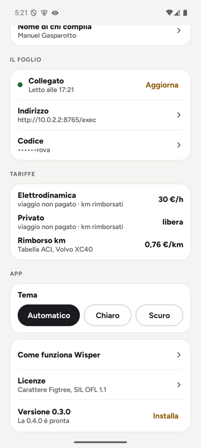
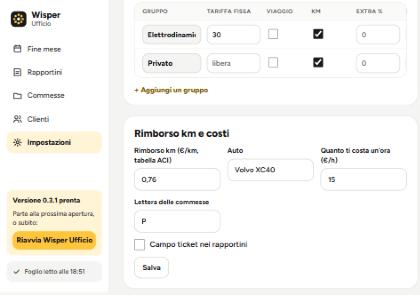

*Le due schermate vengono dalle prove degli aggiornamenti, con numeri di versione
di prova.*

Commit: [85070e0](https://github.com/postagaspa-star/wisper/commit/85070e0),
[9dc84cd](https://github.com/postagaspa-star/wisper/commit/9dc84cd),
[e46f6c6](https://github.com/postagaspa-star/wisper/commit/e46f6c6),
[b25691e](https://github.com/postagaspa-star/wisper/commit/b25691e),
[525e0fc](https://github.com/postagaspa-star/wisper/commit/525e0fc),
[8f05c6d](https://github.com/postagaspa-star/wisper/commit/8f05c6d)

---

## 15 ottobre 2026, sera · Nuovo design

**Perché.** La prima versione a mano funzionava, ma *"ora dobbiamo però sistemare
tutto il design"*. Prima di disegnare è stata fatta una ricerca (principi di UX,
app dello stesso tipo), partendo da chi la usa: un perito che compila dal
telefono in cantiere, spesso al sole e di fretta, e che a fine mese in ufficio
deve fatturare. Dal prototipo cliccabile, approvato, si è passati alle app vere.

**Cosa cambia.**

- **Il telefono si apre su Oggi:** il rapportino di oggi è scritto? quali giorni
  della settimana mancano (tratteggiati, un tocco per scriverli)? cosa c'è da far
  firmare?
- **Un rapportino sono tre passi brevi** (per chi, ore e strada, il lavoro) e un
  riepilogo, con il totale che sale in fondo mentre si compila. L'app ricorda,
  così si conferma soltanto: clienti e commesse recenti come schede grandi,
  "Come ieri", i km dell'ultima volta, l'ultima tariffa del cliente.
- **Wisper Ufficio si apre su Fine mese:** cosa è pronto da fatturare, una scheda
  per chi paga, poi *Prepara riepilogo*, *Invia per email* e *Segna fatturati*.
- **Stessa famiglia sui due:** tema chiaro caldo (si legge al sole) e tema scuro,
  carattere Figtree, bordi al posto delle ombre, il giallo solo sull'azione
  principale.
- **Niente testi d'aiuto fissi sotto i campi:** al loro posto c'è una visita
  guidata sulle schermate vere, con dati di esempio, la prima volta.
- La guida al design è in [`docs/aspetto.md`](docs/aspetto.md), il prototipo in
  [`docs/prototipo/`](docs/prototipo/).

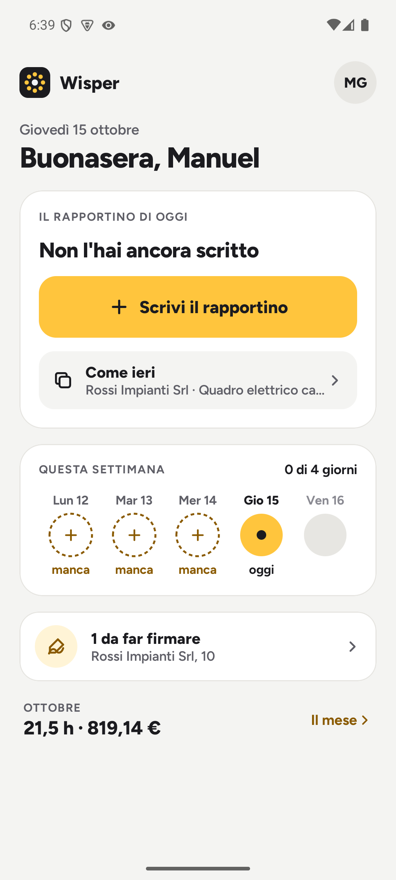
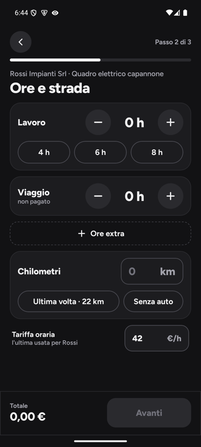
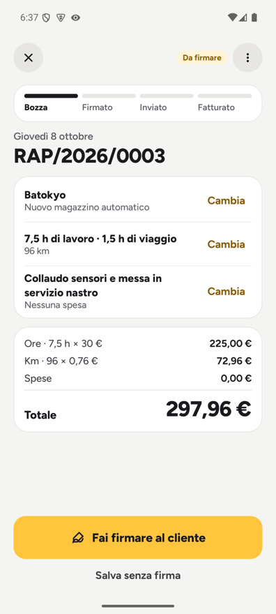
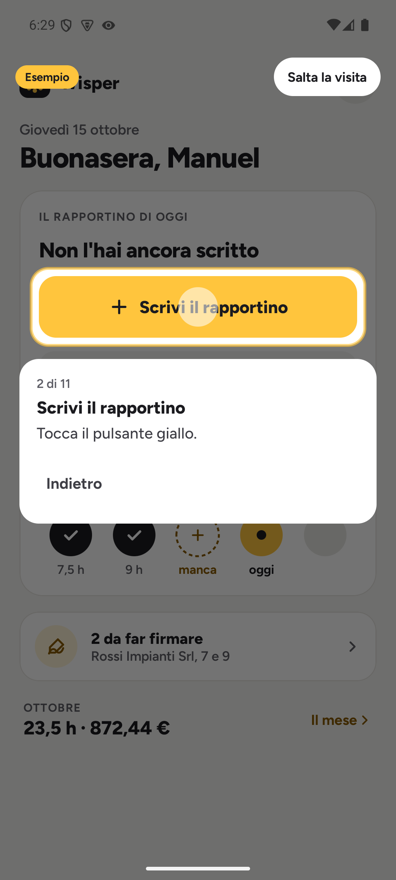

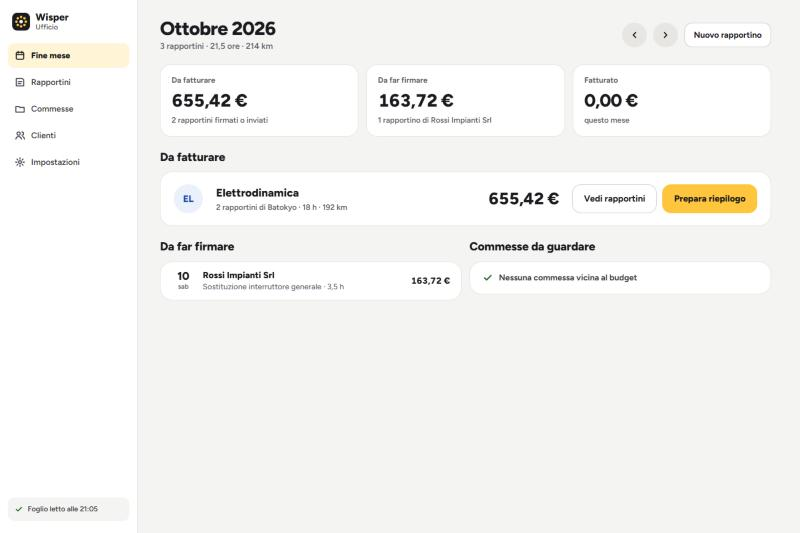

Commit: [7c68923](https://github.com/postagaspa-star/wisper/commit/7c68923),
[4449243](https://github.com/postagaspa-star/wisper/commit/4449243),
[f3239ee](https://github.com/postagaspa-star/wisper/commit/f3239ee)

---

## 14–15 ottobre 2026 · 0.2.0 · Niente più voce: rapportini a mano

**Perché.** *"Dobbiamo modificare Wisper, e renderlo veramente utile per mio
padre."* Ne abbiamo parlato con lui in una conversazione registrata, e abbiamo provato
la demo di [Pleya](https://pleya.it), un gestionale che gli piaceva. Di Pleya si
prende solo quello che serve ai rapportini: i progetti (qui *commesse*) e i
rapporti del team, ridotti a una persona sola. A questo si aggiunge quello che ha
chiesto lui, come i codici commessa e i clienti.

Sulla voce il papà è stato chiaro: *"lascia stare la voce, facciamola a mano"*.
Sulle tariffe: Elettrodinamica ha la sua tariffa fissa; per gli altri clienti
serve un campo dove scrivere la cifra, e l'app deve ricordarsi l'ultima tariffa
usata per quel cliente e riproporla.

**Cosa cambia.**

- **Via la voce,** tutta: parola di attivazione, riconoscimento, Gemini, servizio
  in ascolto, posizione. Resta quello che valeva: la coda che non perde i
  rapportini, e il foglio come unico archivio.
- **Il rapportino si scrive a mano**, in una schermata, dalla data alla firma del
  cliente. Oggi è la data proposta; scegliendo la commessa si compila il
  cliente; clienti e commesse nuovi li crea il foglio. Foto delle spese, firma
  del cliente col dito, e un rapportino firmato non si modifica più finché non
  torna in bozza.
- **Il foglio diventa il cervello:** clienti, commesse, tariffe e conti si fanno
  solo nello script, e niente risponde senza il codice. Le tariffe vengono
  "congelate" nella riga, così aggiornare il costo ACI a gennaio non riscrive
  luglio. Foto e firme vanno in una cartella Wisper su Drive.
- **Nasce Wisper Ufficio**, il programma per il computer (costruito come Pactum):
  rapportini con filtri e totali, commesse con ore rispetto al budget e margine,
  clienti, impostazioni, i PDF del rapportino e del riepilogo del mese, l'invio
  per email.
- **Un finto Google** fa girare lo script vero senza il foglio vero, per provare
  telefono e computer dall'inizio alla fine.
- Il vecchio modello vocale fuori dall'APK: da 60 MB a 11 MB.

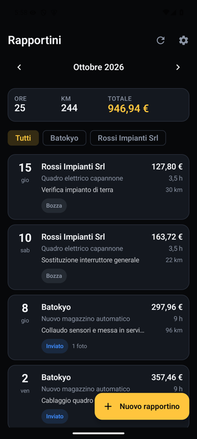
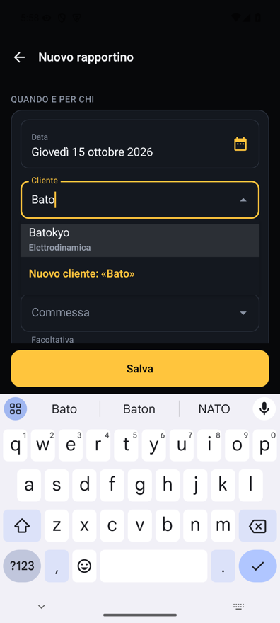
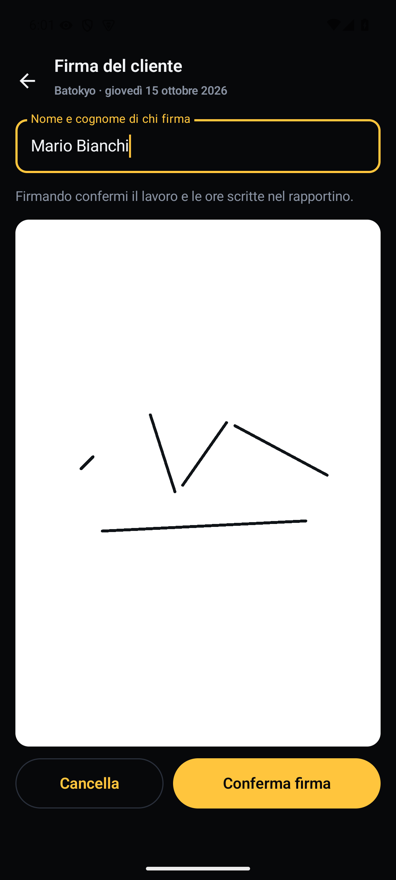

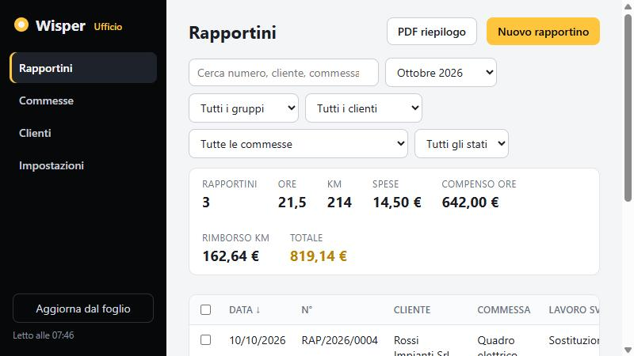
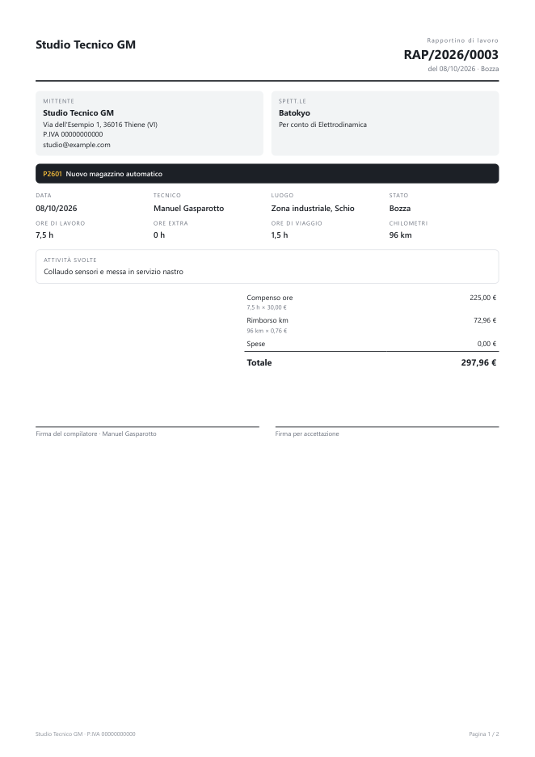

Commit: [3766298](https://github.com/postagaspa-star/wisper/commit/3766298),
[61d0e47](https://github.com/postagaspa-star/wisper/commit/61d0e47),
[e522fd7](https://github.com/postagaspa-star/wisper/commit/e522fd7),
[e9408a6](https://github.com/postagaspa-star/wisper/commit/e9408a6),
[6347de7](https://github.com/postagaspa-star/wisper/commit/6347de7),
[a8a547f](https://github.com/postagaspa-star/wisper/commit/a8a547f),
[8a18b80](https://github.com/postagaspa-star/wisper/commit/8a18b80)

---

## 26 settembre – 14 ottobre 2026 · 0.1 · Un rapportino confermato non si perde più

**Perché.** Usando la versione a voce erano venuti fuori dei problemi: *"non parte
se lo chiami senza aprire l'app, risponde dopo un sacco di secondi e spesso non
capisce quello che gli viene detto"*. E una domanda: *"se io chiudo il telefono
mentre sta salvando, il processo di salvataggio si interrompe oppure continua in
modo autonomo? Perché secondo me dovrebbe continuare."*

**Cosa cambia.** Un rapportino confermato va prima in una coda sul telefono, ed
esce dalla coda solo quando il foglio risponde che l'ha salvato. Se manca la
rete riprova, e riparte appena la rete torna; il foglio riconosce un reinvio e
non scrive la riga due volte. Il riconoscimento vocale ripartiva da solo se si
fermava prima di aver sentito qualcosa, e ogni chiamata al modello aveva un tempo
massimo. Della versione a
voce, questa coda è la parte rimasta anche dopo.

Commit: [4bbc891](https://github.com/postagaspa-star/wisper/commit/4bbc891)

---

## 7–9 agosto 2026 · 0.1.0 · Hackathon NGN Hacks: la versione a voce

**Perché.** Per l'hackathon NGN Hacks 2026, Wisper è stata rifatta come app Android
nativa, voice-first: si doveva attivare come un assistente vocale, anche a
schermo spento, e compilare il rapportino senza usare le mani. Il riconoscimento
vocale era sempre stato il punto debole del progetto. Tempo a disposizione: due
giorni.

**Cosa c'era.**

- **Parola di attivazione "Wisper"**, riconosciuta sul telefono senza internet.
  "Ehi Wisper" veniva capito male, così è bastato "Wisper".
- **Una palla di puntini** che dice di chi è il turno anche da un metro: bianca in
  attesa, gialla quando ascolta (con un microfono sopra), blu quando parla
  Wisper. Mentre si parla compare la scheda del rapportino, che si compila da
  sola.
- **Frasi naturali,** non elenchi: *"Oggi hai lavorato per Rossi con la commessa
  …, hai percorso 3 km e il lavoro è durato 4 ore, è tutto corretto?"*, e quello
  che manca detto in un'unica frase, con un solo "però".
- **Campi obbligatori:** cliente, commessa, ore, km e descrizione del lavoro, che
  l'AI riscrive da come la racconta il tecnico. La commessa si nomina con la sua
  descrizione, non con il codice: *"il tecnico non ha tutti i codici in mente"*.
- **Stato della commessa** aperta o chiusa, al posto di un "esito" che non serviva.
  Clienti e commesse nuovi creati a voce, rapportino cancellabile a voce.
- **Riconosce il cantiere dalla posizione** e lo propone ("ho visto che sei nel
  cantiere di …, è corretto?"), usando solo l'ultima posizione nota, mai un
  tracciamento continuo.
- **Il microfono non resta bloccato:** il primo giro teneva il microfono per sé e
  le altre app del telefono non sentivano più niente. Ora Wisper ascolta solo a
  schermo spento o quando è in primo piano.
- Etichette in inglese per i giudici, la voce sempre in italiano.

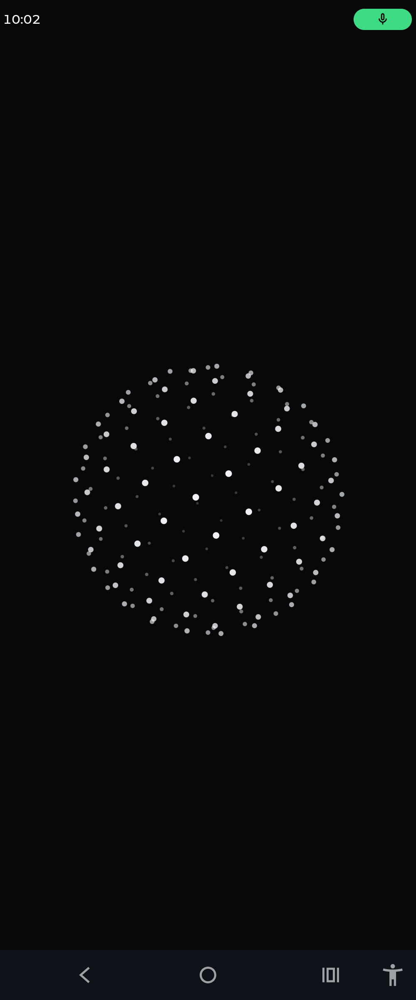
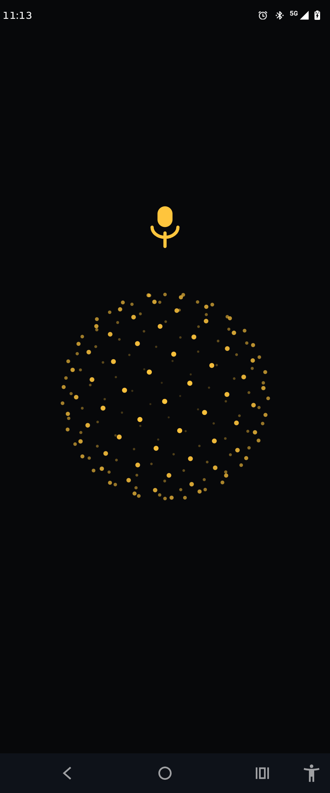
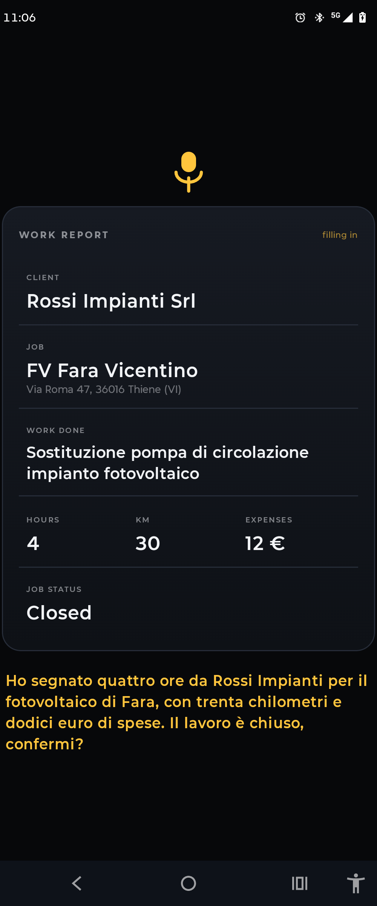

Commit: da [730f5dd](https://github.com/postagaspa-star/wisper/commit/730f5dd) a
[a57a536](https://github.com/postagaspa-star/wisper/commit/a57a536)

---

## Marzo – giugno 2026 · Le prime versioni

Prima di questo repository Wisper era una web app installabile sul telefono, su
Firebase (marzo 2026). Si parlava, Gemini tirava fuori i dati, il rapportino
finiva nel foglio Google; c'erano già la firma del cliente e una coda per quando
manca la rete.

A fine giugno 2026 è stata progettata una versione più completa: clienti e
commesse con un codice proprio, la firma di chi compila salvata una volta nelle
impostazioni invece che a ogni rapportino, chilometri, foto degli scontrini.
Molte di queste idee sono tornate in ottobre, nella 0.2.0.
